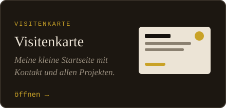

 

### What I've built

<table align="center">
<tr>
<td></td>
<td></td>
</tr>
<tr>
<td></td>
<td></td>
</tr>
</table>

## Where I stand

I'm teaching myself web development in Germany, one step at a time. Every project above
started with a question: How do you build a crossword that builds itself? How do you make
a reaction game feel fair? How do you get a wheel to land on uneven segments?

I've learned more from these than from any tutorial. For example, that a third-party API
can't be trusted to be there (Lesesaal), that a finger is less precise than a mouse (Abyss),
and that you have to account for the time between frames (also Abyss).

I'm looking for my first role as a **junior web developer**.

## My contribution grid

