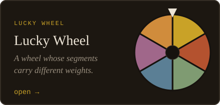
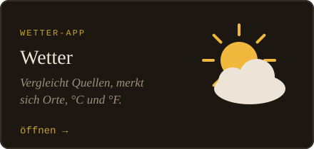
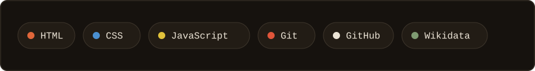

 

### Was ich gebaut habe

<table align="center">
<tr>
<td></td>
<td></td>
</tr>
<tr>
<td></td>
<td></td>
</tr>
</table>

## Wo ich stehe

Ich bringe mir Webentwicklung selbst bei, in Deutschland, Schritt für Schritt.
Jedes Projekt oben ist aus einer Frage entstanden: Wie baut man ein Kreuzworträtsel,
das sich selbst erzeugt? Wie macht man ein Reaktionsspiel fair? Wie bringt man ein Rad
dazu, ungleiche Felder zu treffen?

Dabei habe ich mehr gelernt als in jedem Tutorial. Zum Beispiel, dass eine fremde
Schnittstelle nicht verlässlich ist (Lesesaal), dass ein Finger ungenauer ist als eine
Maus (Abyss) und dass man Zeit zwischen zwei Bildern einrechnen muss (auch Abyss).

Ich suche meine erste Stelle als **Junior Webentwickler**.

## Mein Raster

